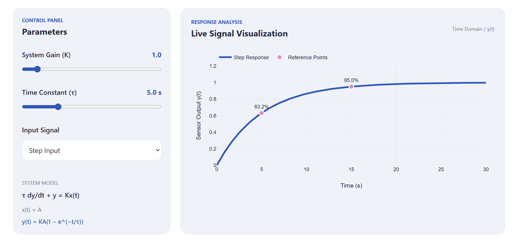
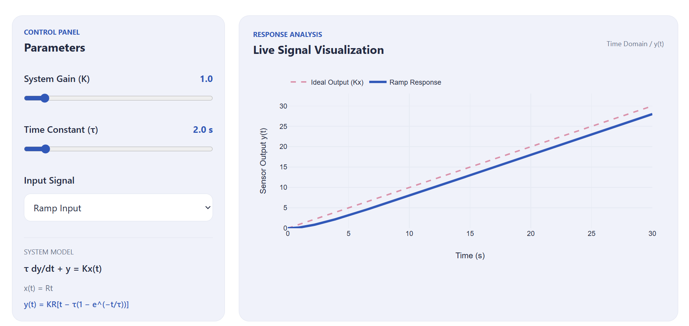
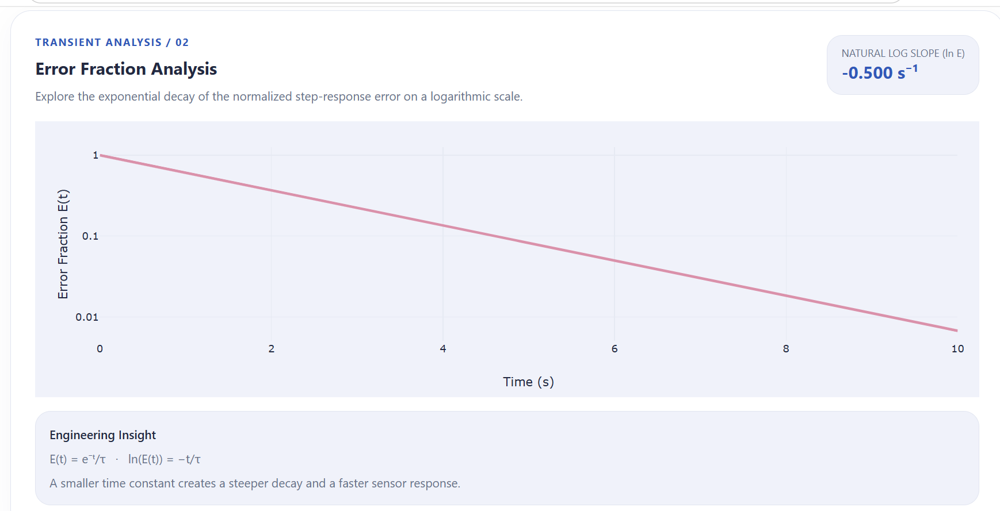
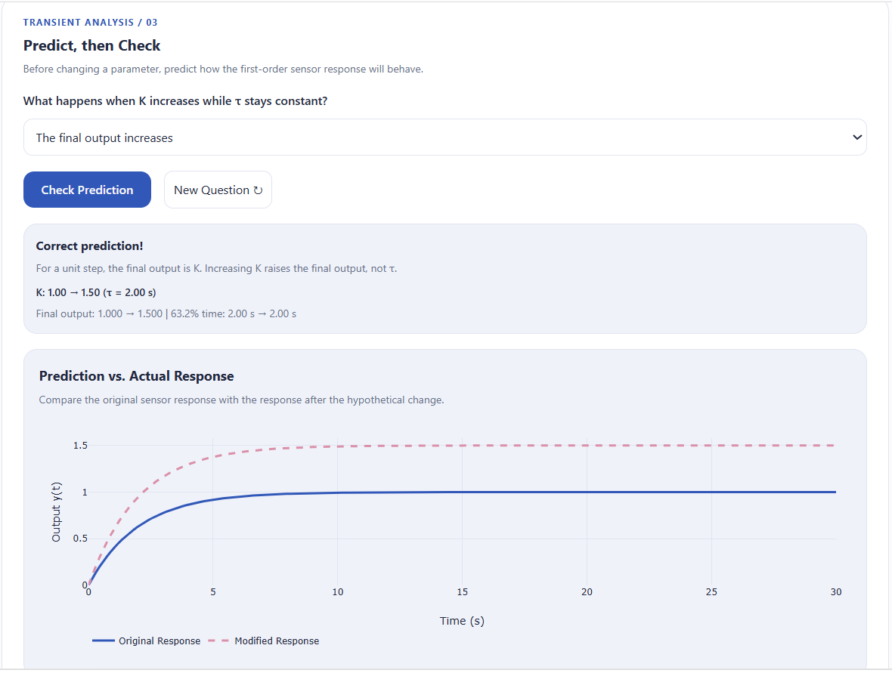

# TRANSIENT — Dynamic Characteristics Interactive Toolkit

**Course:** ENCS4380 – Interfacing Techniques  
**University:** Birzeit University  
**Instructor:** Dr. Wasel Ghanem  
**Assignment:** Homework 1  
**Team:** RSSS

## Project Description

TRANSIENT is an interactive web-based educational toolkit designed to explore the dynamic characteristics of sensors and engineering systems.

The toolkit allows users to adjust system parameters, observe live response plots, predict system behavior, and validate simulation results against analytical reference values.

## Live Website

**GitHub Pages:** https://sojoodasfour.github.io/encs4380-dynamics-Rsss/

**GitHub Repository:** https://github.com/SojoodAsfour/encs4380-dynamics-Rsss

## Team Members and Contributions

| Team Member | Responsibility |
|---|---|
| Sojood Asfour | Module 1: First-Order Time Response; initial website structure and styling |
| Shahd Manasra | Module 2: First-Order Frequency Response |
| Shahd Tamimi | Module 3: Second-Order Response and State-Space Modeling |
| Rahaf Suliman | Module 4: Guess the Sensor; UI and documentation contributions |

## Project Modules

### Module 1 — First-Order Time Response

**Status:** Implemented

- Interactive gain (K) and time constant (τ) sliders.
- Step and ramp input selection.
- Live first-order response visualization.
- Step-response markers at 63.2% (τ) and approximately 95% (3τ).
- Ramp time lag and steady-state error.
- Logarithmic error-fraction plot with natural-log slope −1/τ.
- Interactive Predict, then Check questions for step and ramp responses.
- Official Homework Validation Check #1 with expected values, simulated values, and PASS/FAIL results.

### Module 2 — First-Order Frequency Response

**Status:** In development

- Sinusoidal input and output responses.
- Amplitude ratio and phase lag.
- Bode plots and cutoff frequency.
- Dynamic-error calculations.

### Module 3 — Second-Order Response

**Status:** In development

- Underdamped, critically damped, and overdamped responses.
- Rise time, peak time, overshoot, and settling time.
- Pole visualization.
- State-space modeling and phase-plane visualization.

### Module 4 — Guess the Sensor

**Status:** In development

- Random hidden sensor parameters.
- Interactive parameter estimation.
- Predicted and actual response comparison.
- Scoring and new sensor challenges.

## Technologies Used

- HTML5
- CSS3
- Tailwind CSS v4
- JavaScript
- Plotly.js
- Git and GitHub
- GitHub Pages

The website is a static application that runs directly in the browser without a backend server.

## Validation

The project follows the six official validation checks specified in Homework 1.

Module 1 implements Official Validation Check #1, verifying that the first-order step response reaches approximately 63.2% of its final value at τ and 95% at 3τ.

The remaining official validation checks are assigned to Modules 2 and 3.

## Screenshots

### Module 1 — First-Order Step Response

### Module 1 — Ramp Response

### Module 1 — Error Fraction Analysis

### Module 1 — Predict, then Check

## AI Tool Usage

ChatGPT was used to assist with understanding mathematical
concepts, reviewing JavaScript implementation, improving
responsive design, and explaining validation logic.

All implemented features were reviewed and tested, and team
members are responsible for understanding and explaining
their code and equations.

## Development and Deployment

The project uses feature branches for module development and the `main` branch for GitHub Pages deployment.

Tailwind CSS is compiled into `output.css`, which is included in the repository so that the published website works without a build server.

## Course Milestones

- **Checkpoint 1:** November 3, 2026 — Module 1 working on GitHub Pages.
- **Checkpoint 2:** November 9, 2026 — Modules 2 and 3 working.
- **Final Submission:** November 12, 2026 — All four modules and release `v1.0`.