# TRANSIENT — Dynamic Characteristics & Feedback Control Toolkit

**Course:** ENCS4380 – Interfacing Techniques  
**University:** Birzeit University  
**Instructor:** Dr. Wasel Ghanem  
**Assignment:** Homework 1 & Homework 2  
**Team:** RSSS  
**Project Status:** Homework 1 Completed (v1.0) | Homework 2 Implemented and Simulated

---

## Project Overview

TRANSIENT is an interactive educational website for studying dynamic systems and feedback control.

Homework 1 focuses on system response, frequency analysis, and system identification. Homework 2 extends the toolkit with PID control, sensor feedback, digital control, controller tuning, and a Micromouse motor-speed application.

All simulations and visualizations run directly in the browser.

### Live Links

- **Website:** https://sojoodasfour.github.io/encs4380-dynamics-Rsss/
- **Repository:** https://github.com/SojoodAsfour/encs4380-dynamics-Rsss

---

## Team Members and Contributions

| Team Member | Homework 1 | Homework 2 |
|---|---|---|
| Sojood Asfour | Module 1, website structure and styling | P1 — PID Playground and Control section structure |
| Shahd Manasra | Module 2 — Frequency Response | P2 — A Slow Sensor in the Loop |
| Shahd Tamimi | Module 3 — Second-Order Response | P3 — Digital PID |
| Rahaf Suliman | Module 4 — Guess the Sensor, UI and documentation | P4 — Tuning Challenge |

---

# Homework 1 — Dynamic Characteristics

**Status:** Completed  
**Release:** v1.0

### Module 1 — First-Order Time Response

Interactive first-order simulations with adjustable gain and time constant, step and ramp responses, transient markers, logarithmic error analysis, and Predict, then Check activities.

### Module 2 — First-Order Frequency Response

Sinusoidal input/output visualization, amplitude ratio, phase lag, dynamic error, interactive Bode plots, and cutoff-frequency analysis.

### Module 3 — Second-Order Response

Adjustable mass-spring-damper model, damping classification, transient response metrics, pole visualization, state-space representation, RK4 simulation, and phase-plane analysis.

### Module 4 — Guess the Sensor

Random hidden first-order and second-order systems, noisy measurements, progressive hints, parameter estimation, scoring, and response comparison.

### Homework 1 — Engineering Validation

| Check | Reference Result |
|---|---|
| #1 — First-order step | 63.2% at τ and approximately 95% at 3τ |
| #2 — Sinusoidal response | M ≈ 0.93, φ ≈ 21.8° |
| #3 — Dynamic error | Maximum τ ≈ 0.52 ms |
| #4 — Underdamped response | ζ = 0.5, overshoot ≈ 16.3% |
| #5 — Critically damped response | ζ = 1, overshoot = 0% |
| #6 — State-space poles | −1 ± j1.732 |

The toolkit includes validation panels comparing calculated and expected results.

---

# Homework 2 — Feedback Control Toolkit

**Status:** Implemented and Simulated

Homework 2 introduces four interactive PID control modules. Each module includes a Predict, then Check learning activity.

## P1 — PID Playground

**Contributor:** Sojood Asfour  
**Status:** Implemented and Locally Tested

- First-order and second-order plant selection.
- Adjustable Kp, Ki, Kd, and setpoint.
- Euler-based closed-loop simulation.
- Feedback block diagram and live response plots.
- Control-signal limits and conditional anti-windup.
- Rise time, overshoot, settling time, and steady-state error.
- P, PI, PD, and PID controller comparison.

## P2 — A Slow Sensor in the Loop

**Contributor:** Shahd Manasra  
**Status:** Implemented and Locally Tested

- First-order sensor model in the feedback path.
- Adjustable sensor time constant and PID gains.
- True output, sensor measurement, and setpoint on the same plot.
- Sensor tracking difference, overshoot, and setpoint crossings.
- Demonstration and detection of oscillatory behavior.

## P3 — Digital PID

**Contributor:** Shahd Tamimi  
**Status:** Implemented and Locally Tested

- Discrete-time PID with adjustable gains and sampling time.
- Stair-step control-signal visualization.
- Sampling-time effects on stability and performance.
- Anti-windup ON/OFF.
- Generated Arduino-style PID code with a copy button.

## P4 — Tuning Challenge

**Contributor:** Rahaf Suliman  
**Status:** Implemented and Locally Tested

- Random hidden first-order and second-order plants.
- Open-loop step test and plant-type identification.
- Interactive PID tuning.
- Overshoot, settling-time, and steady-state-error specifications.
- Individual PASS/FAIL results and scoring.

---

## Homework 2 — P1 Engineering Validation

All three official reference checks passed during local testing.

| Test | Expected | Calculated | Status |
|---|---|---|---|
| P-only: K=1, τ=1, Kp=9 | τcl=0.1 s, SSE=10% | 0.0998 s, 10.00% | PASS |
| PI: Kp=1, Ki=1 | ωn=1, ζ=1 | 1.000, 1.000 | PASS |
| Stable PI step tracking | SSE approaches 0% | Approximately 0% | PASS |

For the PI step-tracking test, the simulated residual errors were approximately 0.0000%, 0.0003%, and 0.0000% for the tested gain combinations.

---

# My System — Micromouse Motor Speed Control

**Status:** Implemented and Simulated — Hardware Calibration Pending

### Hardware

- **Motor:** N20 6V DC Gear Motor with Encoder
- **Supplier:** LABCO
- **Microcontroller:** ESP32
- **Motor Driver:** TB6612

### Motor Model

A first-order motor-speed model is used:

G(s) = K / (τs + 1)

| Parameter | Value |
|---|---|
| Motor Gain (K) | 5 RPM/PWM% |
| Time Constant (τ) | 0.25 s |
| Target Speed | 500 RPM |
| Damping Ratio (ζ) | 0.7 |
| Natural Frequency (ωn) | 6 rad/s |

### PI Controller Design

The controller uses pole-placement equations:

Kp = (2ζωnτ − 1) / K

Ki = τωn² / K

Kd = 0

**Final gains:**

- Kp = 0.2200
- Ki = 1.8000
- Kd = 0

### Simulated Performance

| Metric | Result |
|---|---|
| Overshoot | 0.00% |
| Settling Time (2%) | 0.978 s |
| Final Error | 0.00% |
| Maximum PWM | 100% |
| Validation | 6 PASS checks |

The simulated motor reaches the selected 500 RPM target, with PWM reaching its maximum limit of 100%.

These values describe the simulated response. Encoder-based motor calibration remains pending.

### Integration with P1–P3

My System transfers the motor model and normalized PI gains to the control modules.

| Parameter | Normalized Value |
|---|---|
| Plant Gain | 1.00 |
| Time Constant | 0.25 s |
| Kp | 1.1000 |
| Ki | 9.0000 |
| Kd | 0 |

P2 demonstrates sensor delay, while P3 demonstrates digital sampling and anti-windup.

The page also generates a PI controller core using a 20 ms sampling period.

---

## Technologies Used

- HTML5, CSS3, and Tailwind CSS v4
- JavaScript and Plotly.js
- Euler and RK4 numerical simulation
- Git, GitHub, and GitHub Pages

The website runs without a backend server.

## Development and Deployment

- Homework 1 was released as `v1.0`.
- Team members contributed their assigned modules through Git.
- The `main` branch is used for GitHub Pages deployment.
- Compiled Tailwind CSS is included for static hosting.
- Homework 2 extends the existing Homework 1 repository.

---

# Screenshots

## Homework 1 — Module 1

**First-Order Step Response**

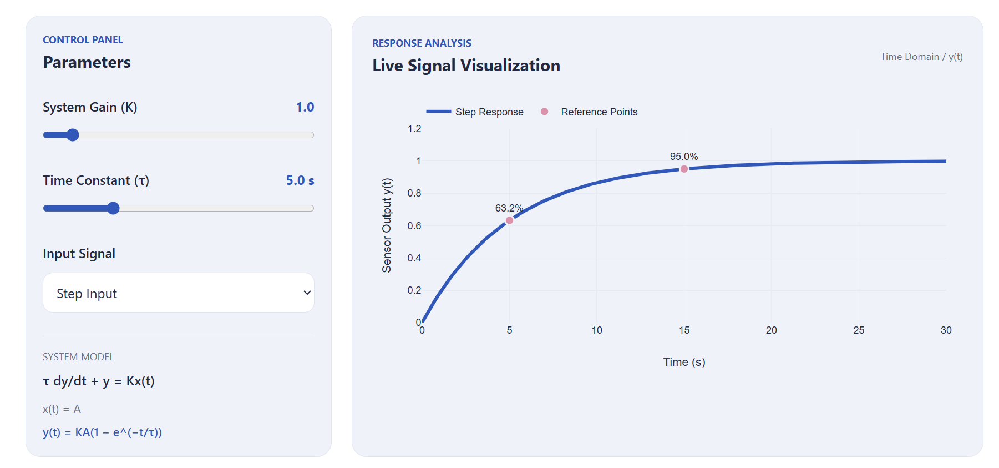

**Ramp Response**

**Error Fraction Analysis**

**Predict, then Check**

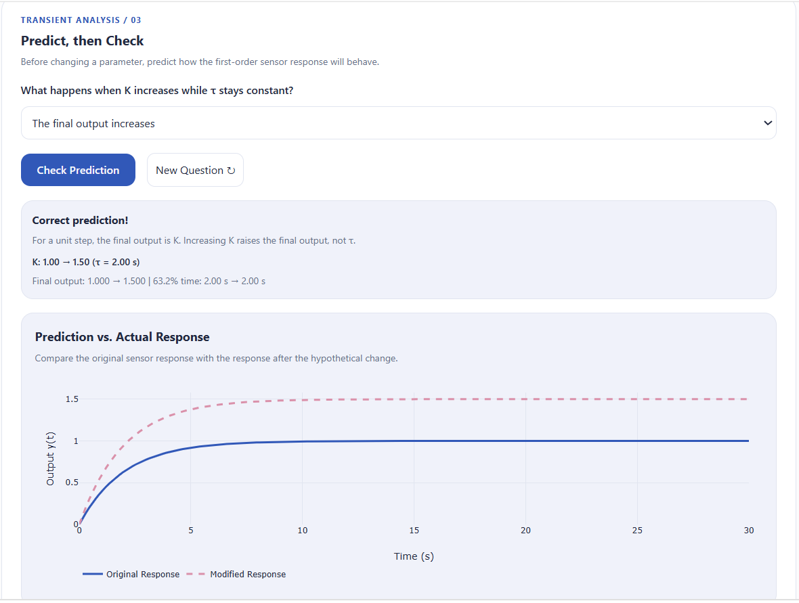

## Homework 1 — Module 2

**First-Order Frequency Response**

**Magnitude and Phase Response**

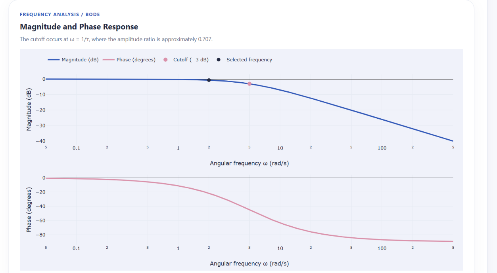

**Official Validation Check #2**

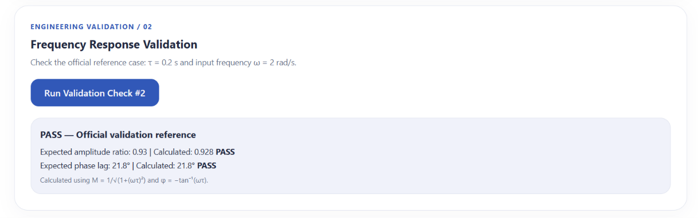

**Dynamic Error Analysis**

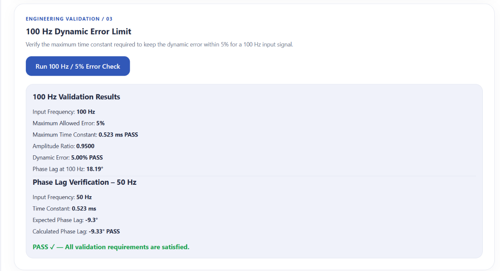

**Predict, then Check**

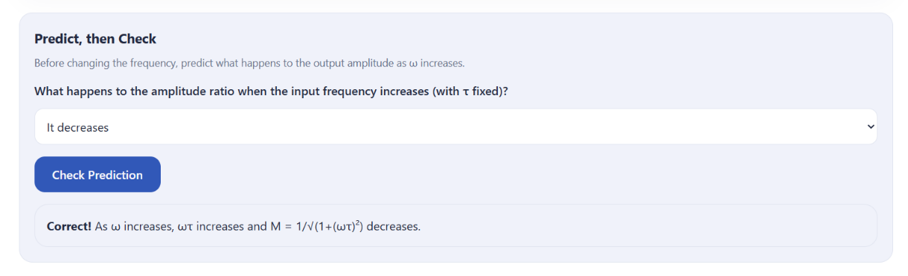

## Homework 1 — Module 3

**Second-Order Response**

**Transient Analysis**

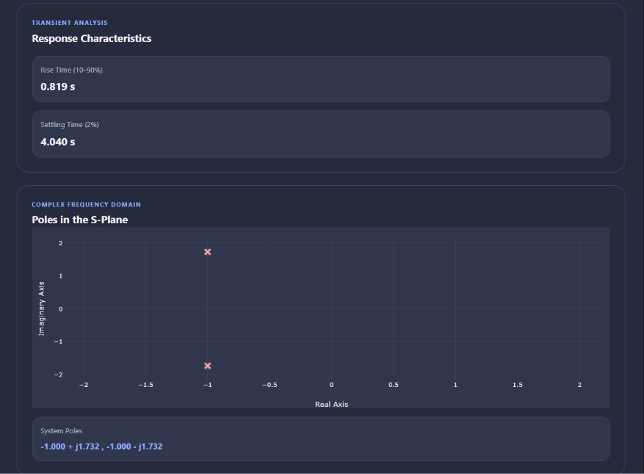

**State-Space Representation**

**Predict, then Check**

**Official Validation Checks #4–#6**

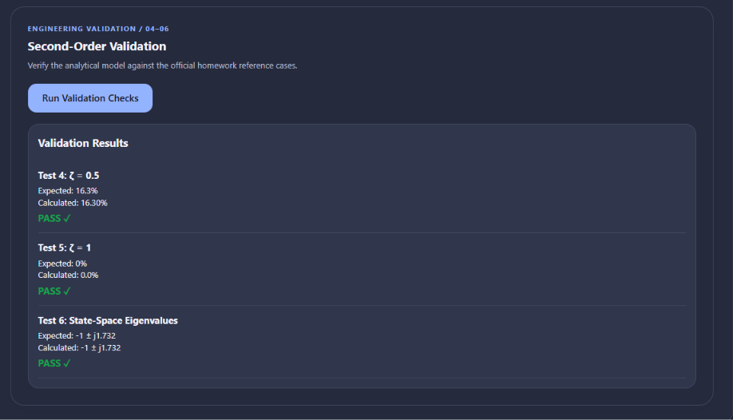

## Homework 1 — Module 4

**Guess the Sensor Challenge**

**First-Order Step Response**

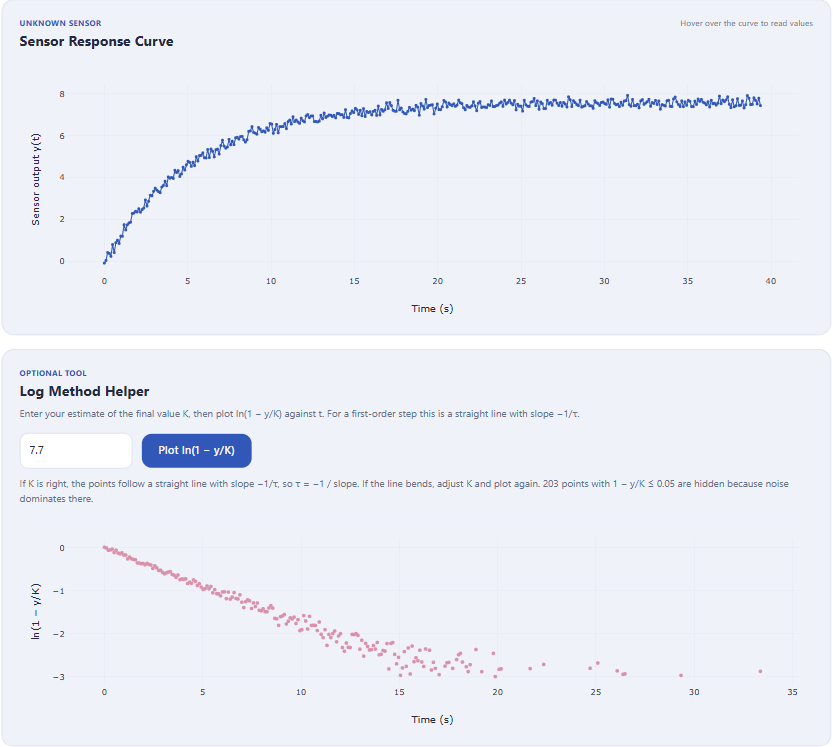

**First-Order Sine Response**

**Progressive Hints**

**Guess Results and Scoring**

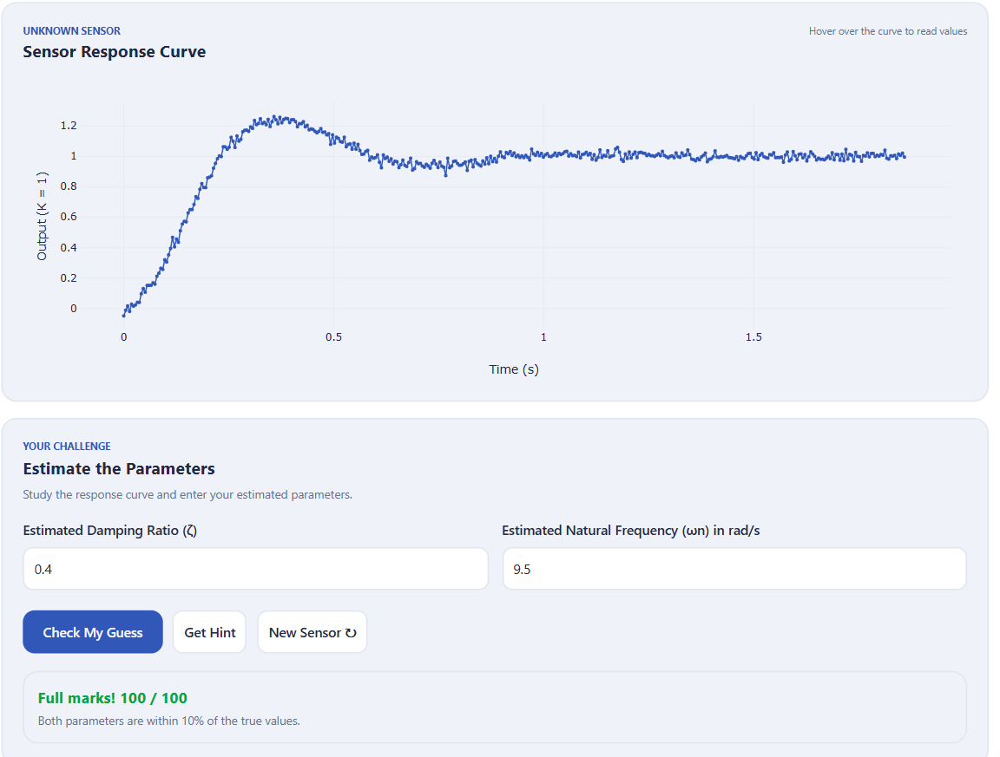

**True Values and Response Comparison**

**Session Scoreboard**

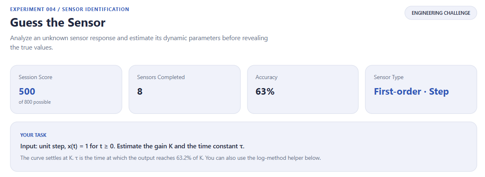

---

## AI Tool Usage

ChatGPT was used to assist with:

- Understanding engineering concepts and equations.
- Reviewing JavaScript and numerical simulation.
- Debugging and validation.
- Interface design and documentation.

All modules were reviewed and tested by their contributors.

---

## Course Milestones

### Homework 1

- November 3, 2026 — Module 1 checkpoint.
- November 9, 2026 — Modules 2 and 3 checkpoint.
- November 12, 2026 — Final release `v1.0`.

### Homework 2

- November 16, 2026 — Assignment released.
- November 19, 2026 — P1 and P2 checkpoint.
- November 23, 2026 — Final submission deadline.