# TRANSIENT — Dynamic Characteristics Interactive Toolkit

**Course:** ENCS4380 – Interfacing Techniques  
**University:** Birzeit University  
**Instructor:** Dr. Wasel Ghanem  
**Assignment:** Homework 1  
**Team:** RSSS

## Project Description

TRANSIENT is an interactive web-based educational toolkit designed to explore the dynamic characteristics of sensors and engineering systems.

The toolkit allows users to adjust system parameters, observe live response plots, predict system behavior, and validate simulation results against analytical reference values.

## Live Website

**GitHub Pages:** https://sojoodasfour.github.io/encs4380-dynamics-Rsss/

**GitHub Repository:** https://github.com/SojoodAsfour/encs4380-dynamics-Rsss

## Team Members and Contributions

| Team Member | Responsibility |
|---|---|
| Sojood Asfour | Module 1: First-Order Time Response; initial website structure and styling |
| Shahd Manasra | Module 2: First-Order Frequency Response |
| Shahd Tamimi | Module 3: Second-Order Response and State-Space Modeling |
| Rahaf Suliman | Module 4: Guess the Sensor; UI and documentation contributions |

## Project Modules

### Module 1 — First-Order Time Response

**Status:** Implemented

- Interactive gain (K) and time constant (τ) sliders.
- Step and ramp input selection.
- Live first-order response visualization.
- Step-response markers at 63.2% (τ) and approximately 95% (3τ).
- Ramp time lag and steady-state error.
- Logarithmic error-fraction plot with natural-log slope −1/τ.
- Interactive Predict, then Check questions for step and ramp responses.
- Official Homework Validation Check #1 with expected values, simulated values, and PASS/FAIL results.

### Module 2 — First-Order Frequency Response

**Status:** Implemented

- Interactive time constant (τ) and input angular frequency (ω) sliders.
- Live sinusoidal input and output response visualization.
- Real-time calculation of amplitude ratio (M) and phase lag (φ).
- Dynamic error (δ) calculation as the frequency changes.
- Interactive Bode plots showing magnitude (dB) and phase (degrees).
- Cutoff frequency calculation and −3 dB point identification.
- Selected-frequency marker on the Bode magnitude plot.
- Interactive Predict, then Check question about the effect of increasing input frequency on amplitude ratio.
- Official Homework Validation Check #2 using the reference values (τ = 0.2 s, ω = 2 rad/s), with expected values, calculated values, and PASS/CHECK results.

### Module 3 — Second-Order Response

**Status:** Implemented

- Interactive mass (m), damping coefficient (b), and spring constant (k) sliders.
- Real-time calculation of natural frequency (ωₙ) and damping ratio (ζ).
- Automatic classification of underdamped, critically damped, and overdamped responses.
- Live second-order step-response visualization.
- Dynamic calculation of rise time, peak time, percentage overshoot, and settling time.
- Interactive pole visualization in the complex S-plane.
- State-space modeling with dynamically updated A and B matrices.
- Real-time calculation and display of system poles and eigenvalues.
- Numerical state-space simulation using the fourth-order Runge-Kutta (RK4) method.
- Interactive phase-plane visualization showing displacement versus velocity.
- Interactive Predict, then Check question about the effect of increasing damping on         oscillations and overshoot.

### Module 4 — Guess the Sensor

**Status:** Implemented

- Random hidden sensor in every round: first-order step, first-order sine, or second-order underdamped step.
- Noise added to the measured response. Values can be read point by point with the hover tooltip.
- Hidden true parameters: K and τ for first-order sensors, ζ and ωn for second-order sensors.
- Estimation with the methods from Modules 1–3: the 63.2% point and the log method for first-order step, phase lag and amplitude ratio for first-order sine, overshoot and peak time for second-order.
- Optional log-method helper that plots ln(1 − y/K) against time for first-order step responses.
- Progressive hints (three levels per sensor type) available on request.
- Scoring: Each parameter within 10% of the true value earns 50 points, while an error between 10% and 20% earns 25 points. Errors above 20% earn 0 points. Each round is worth 100 points.
- A round skipped without checking a guess is not counted.
- Reveal of the true values and a comparison plot that overlays the measured data, the true curve and the estimated curve.
- Running session scoreboard: total score, maximum possible score, completed rounds and accuracy.
- New Sensor button to start another round while keeping the session score.
- Reuse of the response functions from Modules 1, 2 and 3.

## Technologies Used

- HTML5
- CSS3
- Tailwind CSS v4
- JavaScript
- Plotly.js
- Git and GitHub
- GitHub Pages

The website is a static application that runs directly in the browser without a backend server.

## Validation

The project implements the six official validation checks
specified in Homework 1.

### Module 1 — Validation Check #1

- First-order step response:
  y(τ) ≈ 63.2% of KA.
- At 3τ, the response reaches approximately 95% of KA.

### Module 2 — Validation Checks #2 and #3

**Check #2 — Sinusoidal Response**
- Time constant: τ = 0.2 s.
- Input angular frequency: ω = 2 rad/s.
- Expected amplitude ratio: approximately 0.93.
- Expected phase lag: approximately 21.8°.

**Check #3 — Dynamic Error**
- Maximum frequency: 100 Hz.
- Maximum allowable dynamic error: 5%.
- Expected maximum time constant: approximately 0.52 ms.
- Expected phase lag at 50 Hz: approximately 9.3°.

### Module 3 — Validation Checks #4, #5 and #6

**Check #4 — Underdamped Response**
- Damping ratio: ζ = 0.5.
- Expected percentage overshoot: 16.3%.

**Check #5 — Critically Damped Response**
- Damping ratio: ζ = 1.
- Expected overshoot: 0%.

**Check #6 — State-Space Eigenvalues**
- m = 1, b = 2, k = 4.
- Damping ratio: ζ = 0.5.
- Natural frequency: ωn = 2 rad/s.
- Expected eigenvalues: −1 ± j1.732.
- Eigenvalues must match the system poles.

The validation panels display expected values,
calculated values, and PASS/FAIL results.

## Screenshots

### Module 1 — First-Order Step Response

### Module 1 — Ramp Response

### Module 1 — Error Fraction Analysis

### Module 1 — Predict, then Check

### Module 2 — First-Order Frequency Response

### Module 2 — Magnitude and Phase Response

### Module 2 — Official Validation Check #2

### Module 2 — Dynamic Error Analysis

### Module 2 — Predict, then Check

### Module 3 – Second-Order Response
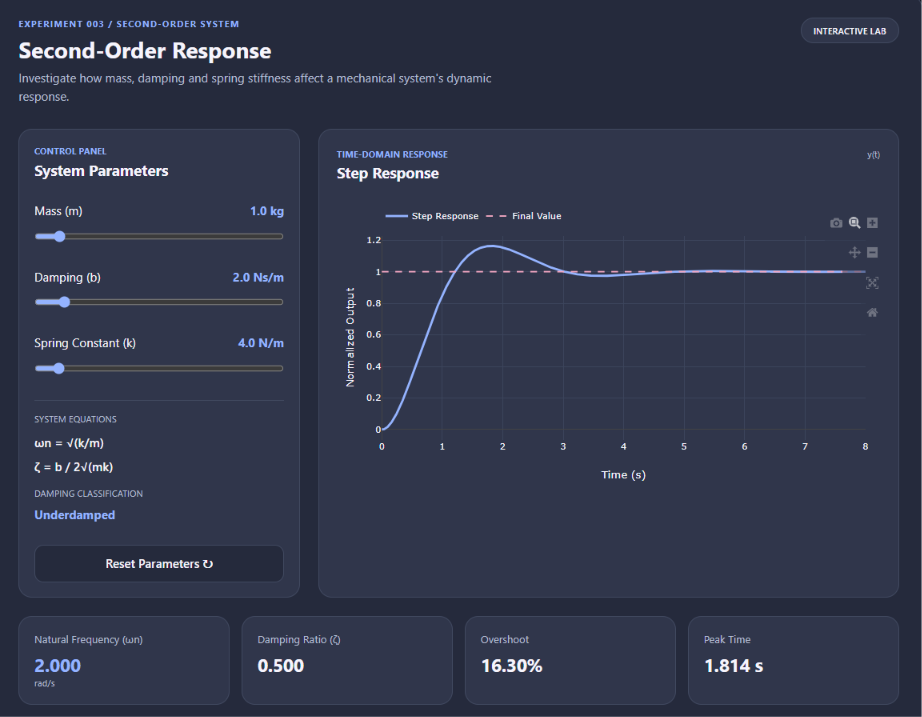

### Module 3 – Transient Analysis
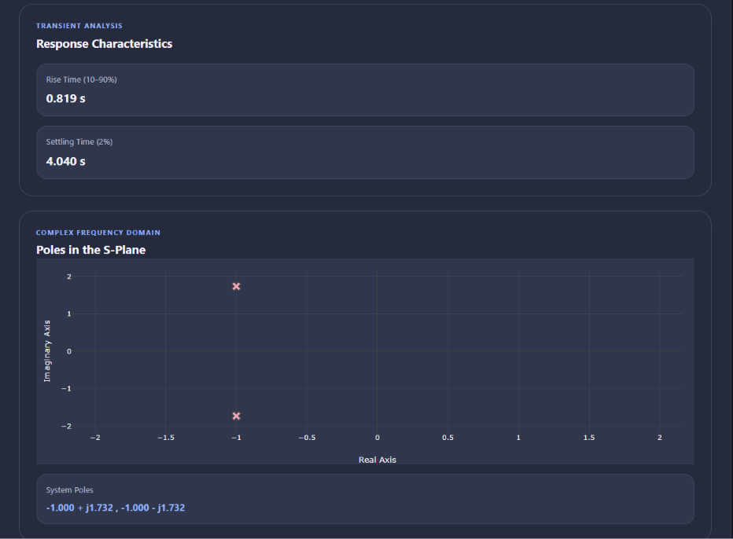

### Module 3 – State-Space Representation
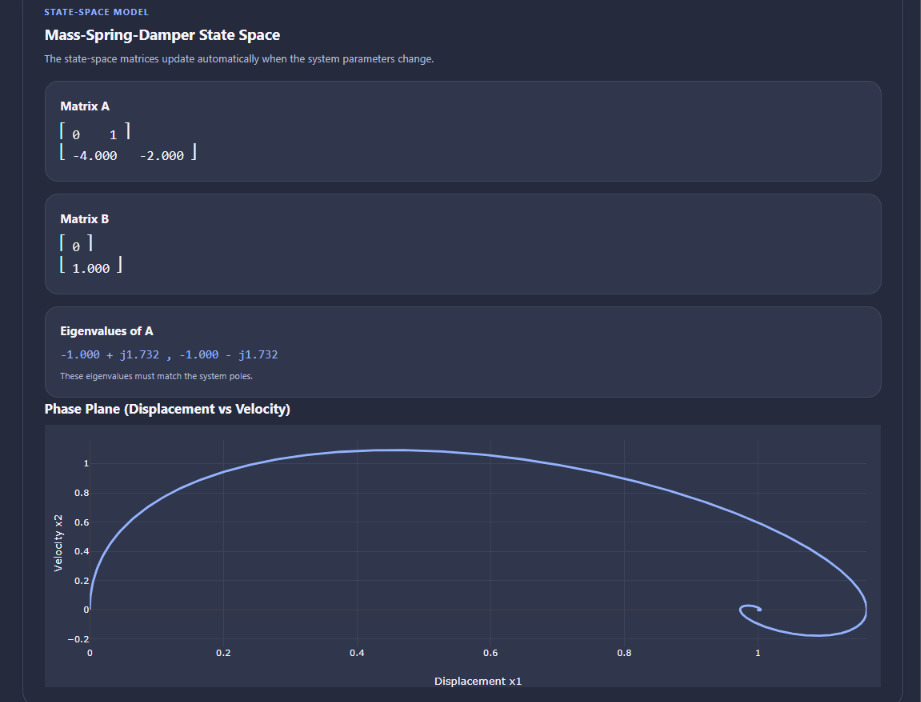

### Module 3 – Predict, then Check
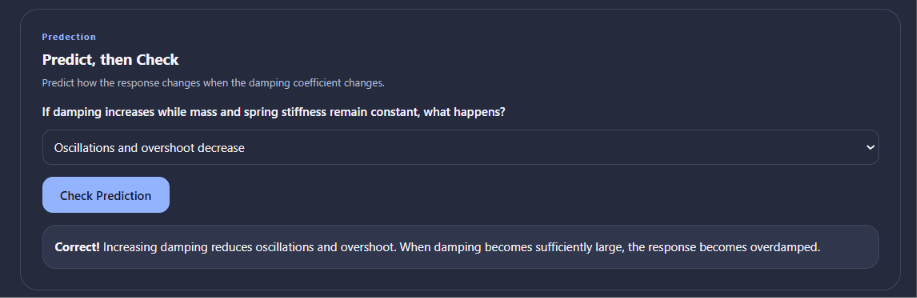

### Module 3 — Official Validation Checks #4–#6
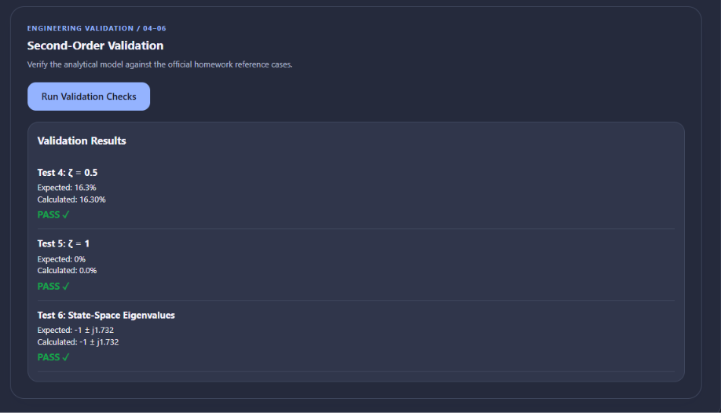

### Module 4 — Guess the Sensor Challenge
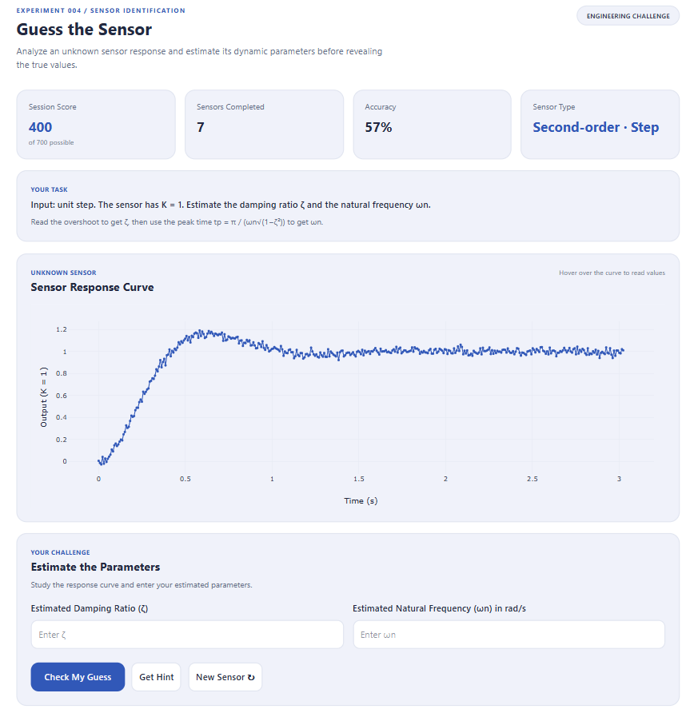

### Module 4 — First-Order Step Response
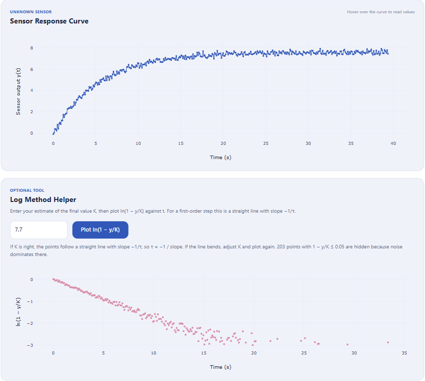

### Module 4 — First-Order Sine Response
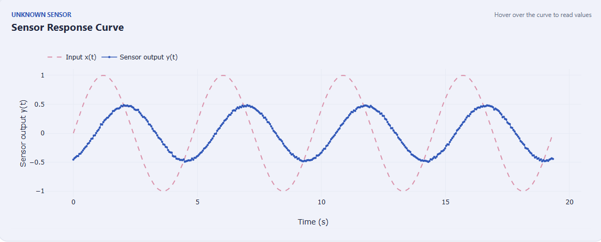

### Module 4 — Progressive Hints
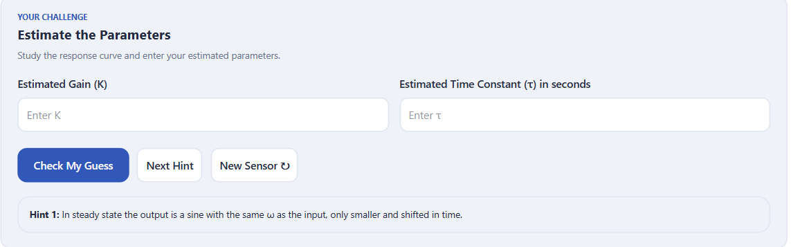

### Module 4 — Guess Results and Scoring
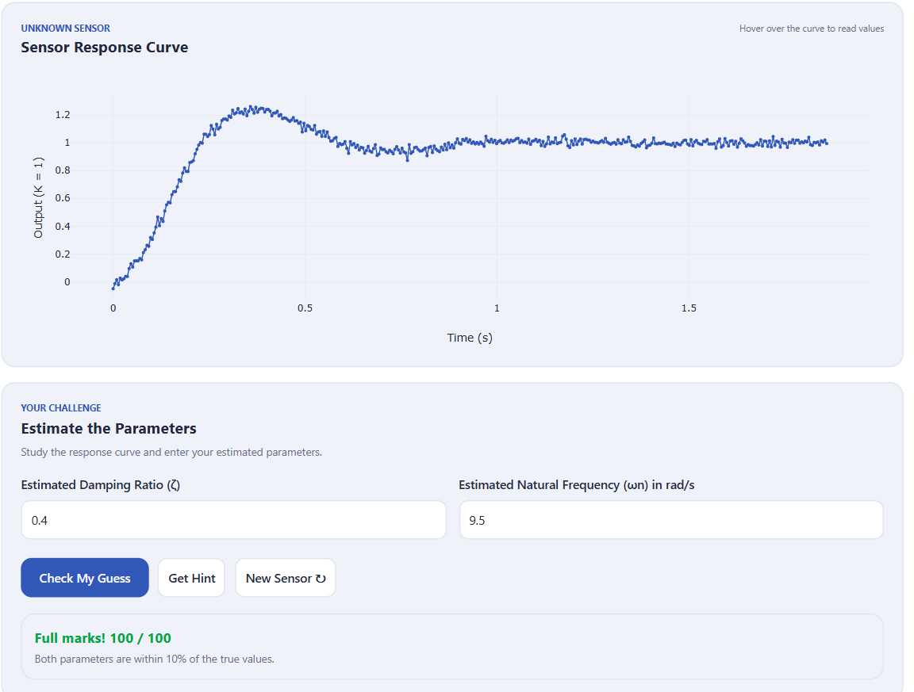

### Module 4 — True Values and Response Comparison
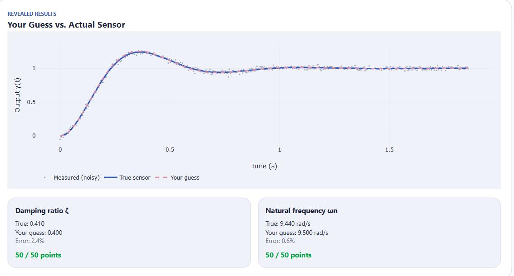

### Module 4 — Session Scoreboard
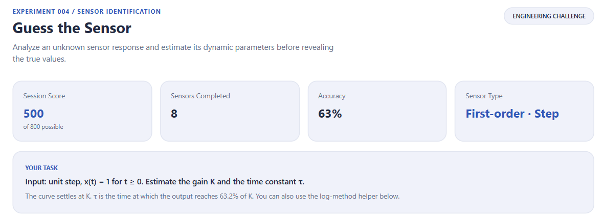

## AI Tool Usage

ChatGPT was used to assist with understanding mathematical
concepts, reviewing JavaScript implementation, improving
responsive design, and explaining validation logic.

All implemented features were reviewed and tested, and team
members are responsible for understanding and explaining
their code and equations.

## Development and Deployment

The project uses feature branches for module development and the `main` branch for GitHub Pages deployment.

Tailwind CSS is compiled into `output.css`, which is included in the repository so that the published website works without a build server.

## Course Milestones

- **Checkpoint 1:** November 3, 2026 — Module 1 working on GitHub Pages.
- **Checkpoint 2:** November 9, 2026 — Modules 2 and 3 working.
- **Final Submission:** November 12, 2026 — All four modules and release `v1.0`.
