# TRANSIENT — Dynamic Characteristics & Feedback Control Toolkit

**Course:** ENCS4380 – Interfacing Techniques  
**University:** Birzeit University  
**Instructor:** Dr. Wasel Ghanem  
**Assignment:** Homework 1 & Homework 2  
**Project Status:** Homework 1 Completed (v1.0) | Homework 2 In Progress  
**Team:** RSSS

---

## Project Description

TRANSIENT is an interactive web-based educational toolkit designed to explore the dynamic characteristics of sensors and engineering systems.

The toolkit allows users to adjust system parameters, observe live response plots, predict system behavior, and validate simulation results against analytical reference values.

Homework 2 extends the toolkit with interactive feedback control experiments, PID controller design, first-order and second-order plant simulations, performance analysis, and a real-world Micromouse application.

The project emphasizes interactive learning, numerical simulation, mathematical understanding, and engineering validation.

## Live Website

**GitHub Pages:** https://sojoodasfour.github.io/encs4380-dynamics-Rsss/

**GitHub Repository:** https://github.com/SojoodAsfour/encs4380-dynamics-Rsss

---

## Team Members and Contributions

| Team Member | Responsibility |
|---|---|
| Sojood Asfour | Homework 1: Module 1 — First-Order Time Response, initial website structure and styling. Homework 2: P1 — PID Playground and Control section structure. |
| Shahd Manasra | Homework 1: Module 2 — First-Order Frequency Response. |
| Shahd Tamimi | Homework 1: Module 3 — Second-Order Response and State-Space Modeling. |
| Rahaf Suliman | Homework 1: Module 4 — Guess the Sensor; UI and documentation contributions. P4 —  Tuning Challenge. |

Homework 2 contributions will be updated as the remaining modules are completed and integrated.

---

# Homework 1 — Dynamic Characteristics

**Status:** Completed  
**Release:** v1.0

## Homework 1 — Project Modules

### Module 1 — First-Order Time Response

**Status:** Implemented

- Interactive gain (K) and time constant (τ) sliders.
- Step and ramp input selection.
- Live first-order response visualization.
- Step-response markers at 63.2% (τ) and approximately 95% (3τ).
- Ramp time lag and steady-state error.
- Logarithmic error-fraction plot with natural-log slope −1/τ.
- Interactive Predict, then Check questions for step and ramp responses.
- Official Homework Validation Check #1 with expected values, simulated values, and PASS/FAIL results.

### Module 2 — First-Order Frequency Response

**Status:** Implemented

- Interactive time constant (τ) and input angular frequency (ω) sliders.
- Live sinusoidal input and output response visualization.
- Real-time calculation of amplitude ratio (M) and phase lag (φ).
- Dynamic error (δ) calculation as the frequency changes.
- Interactive Bode plots showing magnitude (dB) and phase (degrees).
- Cutoff frequency calculation and −3 dB point identification.
- Selected-frequency marker on the Bode magnitude plot.
- Interactive Predict, then Check question about the effect of increasing input frequency on amplitude ratio.
- Official Homework Validation Check #2 using the reference values (τ = 0.2 s, ω = 2 rad/s), with expected values, calculated values, and PASS/CHECK results.

### Module 3 — Second-Order Response

**Status:** Implemented

- Interactive mass (m), damping coefficient (b), and spring constant (k) sliders.
- Real-time calculation of natural frequency (ωₙ) and damping ratio (ζ).
- Automatic classification of underdamped, critically damped, and overdamped responses.
- Live second-order step-response visualization.
- Dynamic calculation of rise time, peak time, percentage overshoot, and settling time.
- Interactive pole visualization in the complex S-plane.
- State-space modeling with dynamically updated A and B matrices.
- Real-time calculation and display of system poles and eigenvalues.
- Numerical state-space simulation using the fourth-order Runge-Kutta (RK4) method.
- Interactive phase-plane visualization showing displacement versus velocity.
- Interactive Predict, then Check question about the effect of increasing damping on oscillations and overshoot.

### Module 4 — Guess the Sensor

**Status:** Implemented

- Random hidden sensor in every round: first-order step, first-order sine, or second-order underdamped step.
- Noise added to the measured response, with point-by-point values accessible through hover tooltips.
- Hidden true parameters: K and τ for first-order sensors, ζ and ωₙ for second-order sensors.
- Estimation using methods from Modules 1–3:
  - The 63.2% point and logarithmic method for first-order step responses.
  - Phase lag and amplitude ratio for first-order sine responses.
  - Overshoot and peak time for second-order responses.
- Optional log-method helper that plots ln(1 − y/K) against time for first-order step responses.
- Progressive hints with three levels per sensor type.
- Scoring system:
  - Each parameter within 10% of the true value earns 50 points.
  - Errors between 10% and 20% earn 25 points.
  - Errors above 20% earn 0 points.
  - Each round is worth 100 points.
- Rounds skipped without checking a guess are not counted.
- Reveal of true values with a comparison plot showing measured data, the true curve, and the estimated curve.
- Running session scoreboard displaying total score, maximum possible score, completed rounds, and accuracy.
- New Sensor button to start another round while keeping the session score.
- Reuse of the response functions from Modules 1, 2, and 3.

## Homework 1 — Engineering Validation

The project implements the six official validation checks specified in Homework 1.

### Module 1 — Validation Check #1

**First-Order Step Response**

- At t = τ, the response reaches approximately 63.2% of KA.
- At t = 3τ, the response reaches approximately 95% of KA.

### Module 2 — Validation Checks #2 and #3

**Check #2 — Sinusoidal Response**

- Time constant: τ = 0.2 s.
- Input angular frequency: ω = 2 rad/s.
- Expected amplitude ratio: approximately 0.93.
- Expected phase lag: approximately 21.8°.

**Check #3 — Dynamic Error**

- Maximum frequency: 100 Hz.
- Maximum allowable dynamic error: 5%.
- Expected maximum time constant: approximately 0.52 ms.
- Expected phase lag at 50 Hz: approximately 9.3°.

### Module 3 — Validation Checks #4, #5 and #6

**Check #4 — Underdamped Response**

- Damping ratio: ζ = 0.5.
- Expected percentage overshoot: 16.3%.

**Check #5 — Critically Damped Response**

- Damping ratio: ζ = 1.
- Expected overshoot: 0%.

**Check #6 — State-Space Eigenvalues**

- m = 1, b = 2, k = 4.
- Damping ratio: ζ = 0.5.
- Natural frequency: ωₙ = 2 rad/s.
- Expected eigenvalues: −1 ± j1.732.
- Eigenvalues must match the system poles.

The validation panels display expected values, calculated values, and PASS/FAIL results.

---

# Homework 2 — Feedback Control Toolkit

**Status:** In Progress

Homework 2 extends TRANSIENT from sensor dynamics analysis to closed-loop feedback control.

The Control section introduces interactive PID experiments, numerical simulations, controller tuning, and an application to the Micromouse robotics project.

The toolkit is organized into four control modules and one project application.

## P1 — PID Playground

**Status:** Implemented and Locally Tested  
**Contributor:** Sojood Asfour

The PID Playground allows users to explore how proportional, integral, and derivative control affect the performance of different dynamic systems.

### Plant Selection

- Interactive selection between first-order and second-order plants.
- Adjustable first-order plant parameters:
  - System gain (K).
  - Time constant (τ).
- Adjustable second-order plant parameters:
  - Mass (m).
  - Damping coefficient (b).
  - Spring constant (k).

### PID Controller

- Interactive proportional gain (Kp) control.
- Interactive integral gain (Ki) control.
- Interactive derivative gain (Kd) control.
- Adjustable reference setpoint.
- Support for P, PI, PD, and PID controller configurations.

### Numerical Simulation

- First-order and second-order closed-loop simulations.
- Euler-based numerical integration for solving system differential equations.
- Derivative control applied to measured output to avoid setpoint-induced derivative kick.
- Actuator saturation limits.
- Conditional integral anti-windup.
- Real-time recalculation when controller or plant parameters change.

### Live Visualization

- Interactive closed-loop feedback block diagram.
- Dynamic display of controller gains and selected plant model.
- Live plot of actual plant output compared with the desired setpoint.
- Live plot of applied control signal with actuator limits.
- Responsive plotting using Plotly.js.
- Compatibility with the website's Light and Dark themes.

### Response Characteristics

Dynamic calculation of:

- Rise time (10–90%).
- Percentage overshoot.
- Settling time using the 2% criterion.
- Steady-state error estimate.

The interface also identifies responses that do not settle within the simulated time window or are classified as undamped or unstable.

### Predict, then Check

- Interactive prediction activity focused on proportional control.
- Comparison of two proportional gains using numerical simulation.
- Evaluation of the user's prediction.
- Explanation of the effect of increasing Kp on steady-state error.

### Engineering Validation

- Three official validation checks.
- Comparison of expected and calculated values.
- PASS/FAIL results.
- Numerical verification using the same simulation functions as the interactive plots.

### Additional Testing

- First-order P-only, PI, PD, and PID responses.
- Second-order system responses.
- Undamped oscillatory behavior.
- Actuator saturation.
- Comparison between theoretical and numerical results.

## P2 — A Slow Sensor in the Loop

**Status:** In Progress

Investigates the effect of sensor dynamics and measurement delay on closed-loop control performance.

## P3 — Digital PID

**Status:** In Progress

Explores discrete-time PID control, sampling effects, and anti-windup behavior.

### P4 — Tuning Challenge

**Status: Implemented and Locally Tested**
**Contributor:** Rahaf Suliman

The Tuning Challenge provides an interactive environment where users design a PID controller for a hidden dynamic plant and attempt to satisfy specified performance requirements.

### Hidden Plant Generation

- Randomized hidden plant generation for each new challenge.
- Reuse of Homework 1 plant models and response functions.
- Support for first-order and second-order plant behavior.
- Hidden plant parameters that users must identify through system response analysis.
- New Challenge button to generate another challenge.

### Open-Loop Step Test

- Simulation of the hidden plant's open-loop step response.
- Interactive visualization of the output response.
- Analysis of the plant's transient behavior.
- Open-loop response used as a reference for identifying the hidden plant characteristics.

### Plant Identification

- Interactive selection of the estimated plant type.
- Support for first-order and second-order plant classification.
- Check Plant Type functionality to evaluate the user's identification.
- Feedback indicating whether the selected plant type matches the hidden plant.

### PID Controller Tuning

- Adjustable proportional gain (Kp).
- Adjustable integral gain (Ki).
- Adjustable derivative gain (Kd).
- Interactive experimentation with different controller configurations.
- Real-time evaluation of the selected controller gains.

### Performance Specifications

The controller is evaluated against three performance requirements:

- Percentage Overshoot: Must remain below or equal to the specified maximum.
- Settling Time: Must remain within the specified time limit using the 2% criterion.
- Steady-State Error: Must remain below or equal to the specified allowable error.

### Automated Evaluation and Scoring

- Automatic calculation of controller performance metrics.
- Independent PASS/FAIL evaluation for each performance requirement.
- Overall score based on the achieved specifications.
- Submit My Design button to evaluate the current controller configuration.
- Display of the final evaluation results and score after submission.
- New Challenge button resets the previous evaluation and starts a new challenge.

### Interactive Learning

- Users experiment with different PID gains to satisfy the hidden plant's performance specifications.
- Comparison between controller configurations through repeated challenges.
- Predict, then Check learning approach encouraging users to understand the relationship between PID gains and transient response characteristics.

## My System — Micromouse Motor Speed Control

**Status:** In Progress

A real-world engineering application exploring PID-based motor speed control for the Micromouse robot.

The implementation details, mathematical model, simulation results, and engineering analysis will be documented as the project progresses.

---

## Homework 2 — P1 Engineering Validation

The P1 PID Playground implements three official reference checks.

### Test #1 — P-Only Controller

**Plant Parameters**

- K = 1.
- τ = 1 s.

**Controller Parameters**

- Kp = 9.
- Ki = 0.
- Kd = 0.

**Expected Results**

- Closed-loop time constant: 0.1 s.
- Steady-state error: 10%.

**Local Test Results**

- Calculated closed-loop time constant: approximately 0.0998 s.
- Calculated steady-state error: approximately 10.00%.
- Status: PASS.

### Test #2 — PI Controller Characteristics

**Plant Parameters**

- K = 1.
- τ = 1 s.

**Controller Parameters**

- Kp = 1.
- Ki = 1.
- Kd = 0.

**Expected Results**

- Natural frequency: 1 rad/s.
- Damping ratio: 1.
- Step output at t = 1 s: approximately 0.6321.

**Local Test Results**

- Calculated natural frequency: 1.000 rad/s.
- Calculated damping ratio: 1.000.
- Simulated output at t = 1 s: approximately 0.6323.
- Status: PASS.

### Test #3 — PI Zero Steady-State Error

**Objective**

Verify that stable PI-controlled systems approach zero steady-state error for a reachable step setpoint.

The validation uses several proportional and integral gain configurations.

**Tested Configurations**

| Kp | Ki | Simulated Error |
|---|---|---|
| 1 | 1 | Approximately 0.0000% |
| 2 | 1 | Approximately 0.0003% |
| 3 | 2 | Approximately 0.0000% |

**Status:** PASS.

These results represent residual errors after finite-duration numerical simulation. The theoretical steady-state error approaches zero for stable PI-controlled systems with a reachable constant setpoint.

All three P1 validation checks passed during local testing. Further integration and edge-case testing will be performed as the remaining Homework 2 modules are completed.

---

## Technologies Used

- HTML5.
- CSS3.
- Tailwind CSS v4.
- JavaScript.
- Plotly.js.
- Git and GitHub.
- GitHub Pages.

The website is a static application that runs directly in the browser without a backend server.

## Development and Deployment

The project follows a feature-branch development workflow using Git and GitHub.

- Each team member develops assigned functionality on a separate branch.
- Pull requests are used to review and integrate changes.
- The `main` branch is used for GitHub Pages deployment.
- Tailwind CSS is compiled into `output.css`.
- The compiled CSS file is included in the repository so the published website works without a build server.

The Homework 1 release `v1.0` remains available as the original completed version of TRANSIENT.

Homework 2 extends the existing website and is being integrated through additional team contributions.

---

## Screenshots

### Homework 1 — Module 1

**First-Order Step Response**

**Ramp Response**

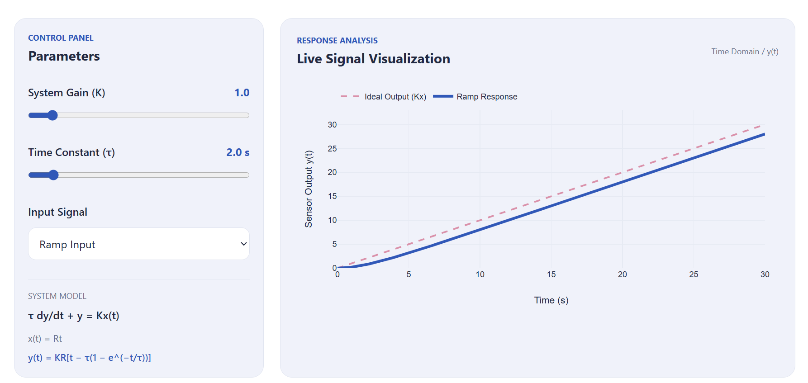

**Error Fraction Analysis**

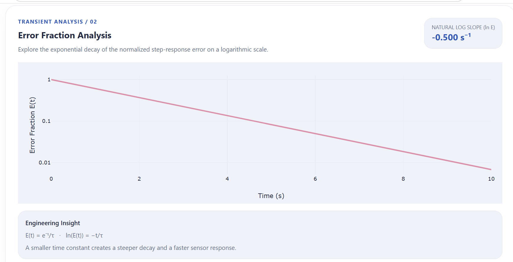

**Predict, then Check**

### Homework 1 — Module 2

**First-Order Frequency Response**

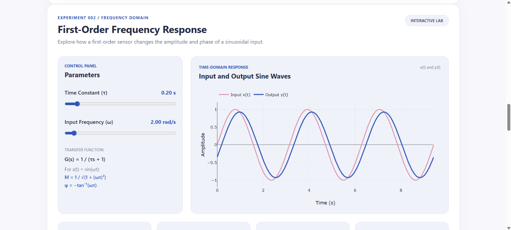

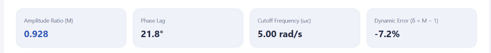

**Magnitude and Phase Response**

**Official Validation Check #2**

**Dynamic Error Analysis**

**Predict, then Check**

### Homework 1 — Module 3

**Second-Order Response**

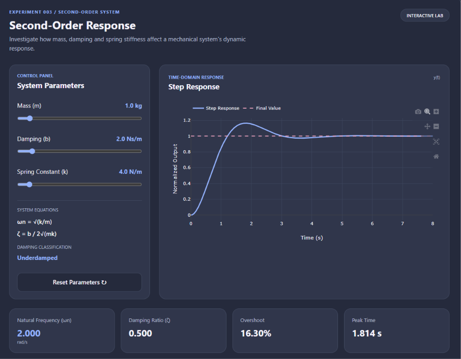

**Transient Analysis**

**State-Space Representation**

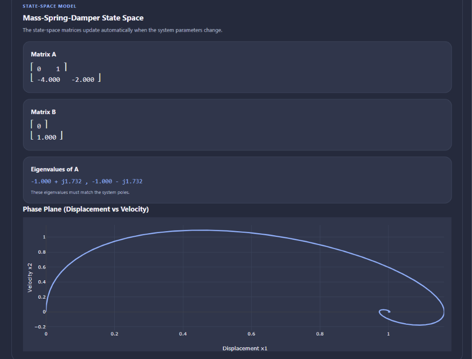

**Predict, then Check**

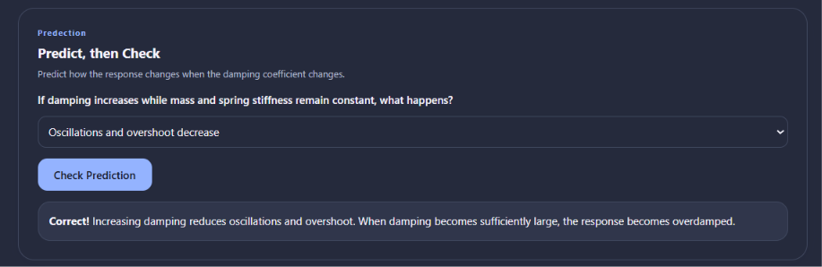

**Official Validation Checks #4–#6**

### Homework 1 — Module 4

**Guess the Sensor Challenge**

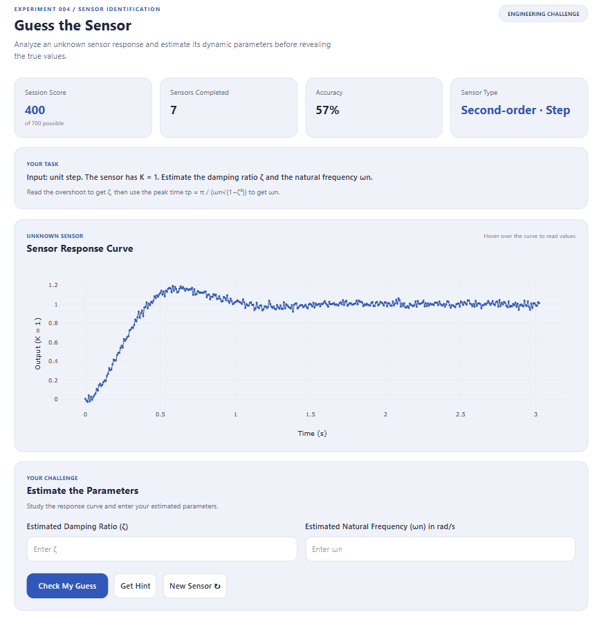

**First-Order Step Response**

**First-Order Sine Response**

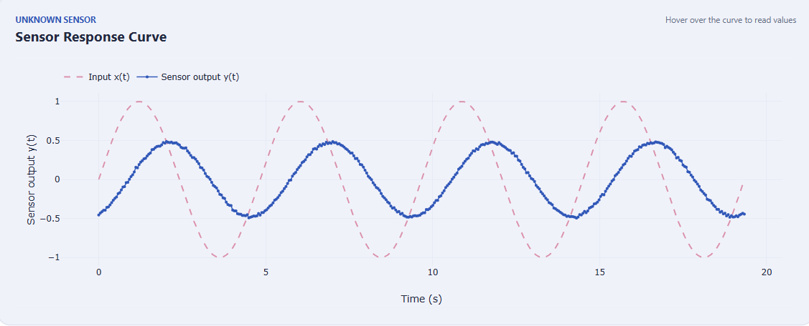

**Progressive Hints**

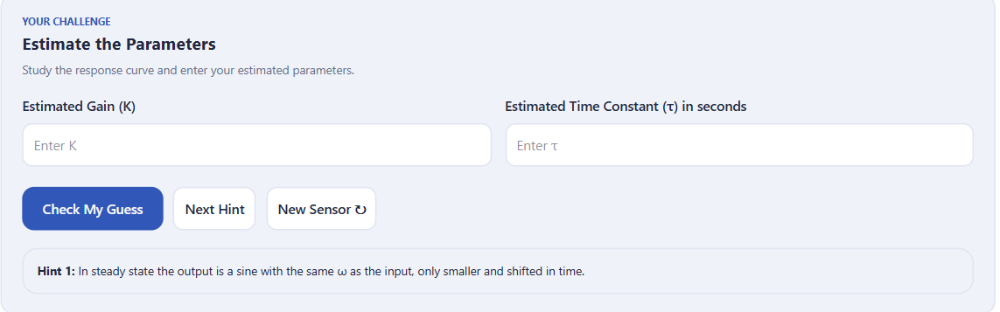

**Guess Results and Scoring**

**True Values and Response Comparison**

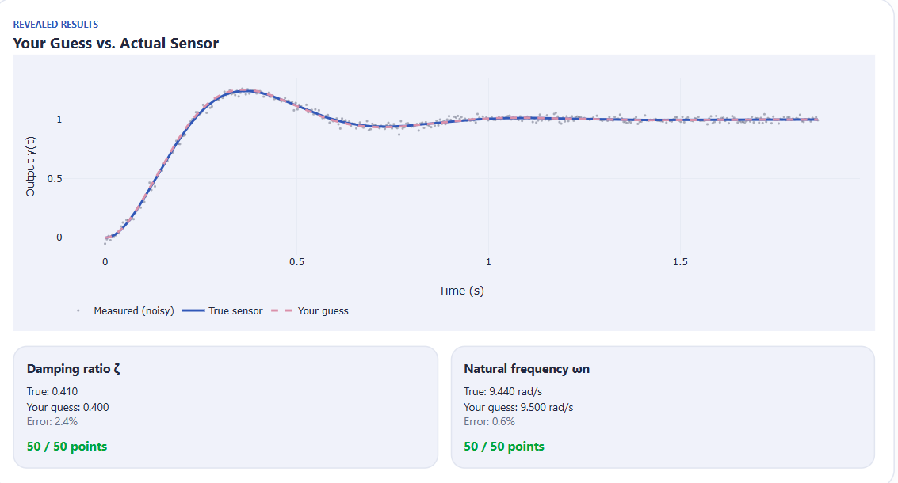

**Session Scoreboard**

## AI Tool Usage

ChatGPT was used to assist with:

- Understanding mathematical and engineering concepts.
- Reviewing JavaScript implementation.
- Explaining numerical simulation methods.
- Improving responsive interface design.
- Reviewing validation logic.
- Supporting debugging and documentation.

All implemented features were reviewed and tested by the team members, who are responsible for understanding and explaining their code and engineering calculations.

---

## Homework 1 — Course Milestones

- **Checkpoint 1:** November 3, 2026 — Module 1 working on GitHub Pages.
- **Checkpoint 2:** November 9, 2026 — Modules 2 and 3 working.
- **Final Submission:** November 12, 2026 — All four modules and GitHub release `v1.0`.

---

## Homework 2 — Development Status

- P1 — PID Playground: Implemented and locally tested.
- P2 — A Slow Sensor in the Loop: In progress.
- P3 — Digital PID: In progress.
- P4 — Tuning Challenge: Implemented and locally tested.
- My System — Micromouse Motor Speed Control: In progress.
